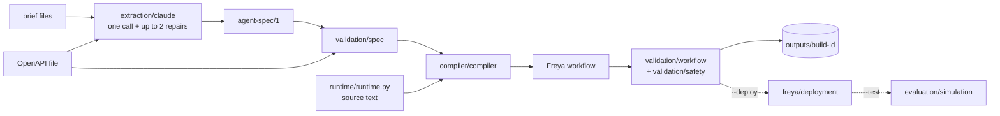

# Architecture

The builder turns a bank's brief and its tool API file into a Freya phone agent. There is one
pipeline and one of everything: one extractor, one spec format, one compiler, one runtime.

## The idea in one paragraph

A language model reads the brief once and writes a compact specification, `agent-spec/1`.
From then on everything is deterministic: the spec is validated against the tool API,
compiled into a six-node Freya workflow, and validated again. The workflow carries two
things: rule text for the phone model, which talks to the person, and a small Python
runtime, embedded in the workflow's code steps and tool hooks, which does the work a model
must not be trusted with: dates, amounts, counting, tool-call limits and the closing outcome.

## Repository

```text
builder/
  __main__.py              python -m builder
  pipeline.py              the stages, in order; the only module that knows all the others
  config/settings.py       paths, defaults, key loading, which variables are secrets
  extraction/claude.py     prompt, Claude call, repair loop
  spec/models.py           agent-spec/1 vocabulary and expression walking
  spec/openapi.py          the bank tool API: operations, fields, $ref
  validation/spec.py       is the spec executable against this API?
  validation/workflow.py   does the workflow obey the platform's rules?
  validation/safety.py     does an artifact carry a credential?
  compiler/compiler.py     spec + API -> workflow; embeds the runtime
  runtime/runtime.py       the deterministic runtime, embedded as source
  freya/client.py          loads the starter kit's freya.py
  freya/deployment.py      dry run, save and publish, export
  freya/versioning.py      slot registry and deployment record
  evaluation/simulation.py the kit's practice customers on Freya
  tracing/trace.py         the build trace, with redaction
  artifacts/store.py       outputs/<build-id>/ and its file names
tests/                     offline tests, one file per area
outputs/                   build artifacts (git-ignored)
local_freya/               the official starter kit (git-ignored)
```

There is no `repair/` package: the repair loop is twenty lines inside the extraction loop
and shares its conversation state, so it stays in `extraction/claude.py`.

## Pipeline



`pipeline.main` runs these stages and writes every result through `artifacts/store` and
every event through `tracing/trace`. The solid part is offline. The dotted part touches
Freya and runs only with its flag. The extraction call runs only with `--live-extract`.

## Module dependencies

Arrows read "imports". `pipeline` imports everything and nothing imports `pipeline` except
`__main__`. There are no cycles; `tests/test_architecture.py` enforces this table.

| Module | Imports |
| --- | --- |
| `runtime/runtime`, `config/settings`, `artifacts/store`, `freya/client`, `evaluation/simulation` | nothing from the builder |
| `spec/models` | `runtime/runtime` (the list of date expression kinds) |
| `spec/openapi` | `spec/models` |
| `validation/spec` | `spec/models`, `runtime/runtime` (to evaluate expressions on sample products) |
| `validation/safety` | `config/settings` |
| `validation/workflow` | `validation/safety` |
| `compiler/compiler` | `spec/models`, `runtime/runtime` (located as a file, embedded as text) |
| `extraction/claude` | `spec/models`, `config/settings` |
| `tracing/trace`, `freya/versioning` | `config/settings` |
| `freya/deployment` | `freya/versioning` |

Only three modules can leave the process: `extraction/claude` (the Anthropic SDK, imported
inside the call), `freya/client` (loads the kit client) and `evaluation/simulation`
(starts the kit's test script).

## agent-spec/1

A spec is one JSON object. `spec/models.py` names its vocabulary; the full field list with
explanations is the prompt in `extraction/claude.py`.

| Part | Fields | Read by |
| --- | --- | --- |
| Call | `language`, `call_variables`, `now_variable`, `opening_line`, `test_variables` | compiler |
| Calendar | `calendar.business_weekdays`, `holidays`, `week_start` | runtime |
| Identity | `identity.questions` (field, wording, format), `max_wrong`, response field names, `hints` | runtime |
| Products | `account.values`: named expressions per product; `account.limits`: which values bound a promise | runtime |
| Tools | `promise`, `note`, `callback`, `transfer`, `close`: field names, callback window, outcome table, `close.forced` | runtime, compiler |
| Guidance | `guidance`: the brief's instruction for a moment after a tool result | runtime |
| Rule text | `rules.always`, `rules.before_verification`, `rules.after_verification`, `tool_descriptions` | phone model |
| Escape hatch | `unsupported`: policy the extractor could not express | validation |

Expressions (`runtime.evaluate`): `by` (cases on product fields), `const`, `text`, `field`,
`percent`, `fixed_amount`, and the date kinds `today`, `next_business_day`,
`business_days_after`, `calendar_days_after`, `last_business_day_of_week`,
`first_business_day_of_week`, `end_of_month`, `fixed_date`, `earliest`, `latest`, `named`,
each with optional `roll` and `not_after`.

## The workflow

```text
setup ──► contact ──► get_account ──► account_facts ──► negotiate ──► end
 code     conversation  api_request      code           conversation   end_call
             └──────────────── close_call succeeded ────────┴──► end
```

| Node | What happens | Tools the phone model has |
| --- | --- | --- |
| `setup` | Resets all runtime state; computes calendar and callback slots from the call's clock | none |
| `contact` | Who is on the line; identity | `verify_identity`, `schedule_callback`, `transfer_to_agent`, `close_call` |
| `get_account` | Run by the engine after identity is fully verified | none |
| `account_facts` | Computes every named value and the limits per product | none |
| `negotiate` | The rest of the call | `create_promise`, `add_note` if the brief uses it, `transfer_to_agent`, `close_call` |
| `end` | Hangs up after `close_call` succeeded | none |

Tools are generated from the tool API file: URL, fields, types, enums. Each conversation
node's prompt is the spec's rule text followed by facts blocks the runtime computed (today,
calendar, callback slots, account facts, live state).

## The embedded runtime

`runtime/runtime.py` is ordinary Python that the tests import directly. The compiler does
not import its functions into the workflow; it reads the file as text (`RUNTIME_SOURCE`),
and for each code step or hook `compiler.runtime_code`:

1. takes the entry function and, by walking the syntax tree, every function it reaches;
2. wraps them, with the configuration as a JSON literal, in one function `_rt`, so they
   see each other under any `exec` scoping;
3. guards the call with `try`, with fallback values for the code steps;
4. refuses to emit code containing a double brace, which Freya would treat as a template.

So the runtime file may use only `json`, `re` and `datetime`, may not import the builder,
and may not contain two consecutive braces. `tests/test_architecture.py` checks all three
and checks that each embedded function equals its source.

State is one JSON string in the workflow variable `rt_state`: identity status, wrong
answers, products with limits, promises, notes, transfers, callback, closed.

## What is enforced in code, and what is not

Enforced by the runtime or by the graph, whatever the phone model does:

| Rule | Where |
| --- | --- |
| No account tool before identity is fully verified | graph: the tools exist only in `negotiate`; `get_account` is engine-run |
| State supplied by the caller is discarded | `setup` |
| Wrong answers counted across questions; hints and unreadable answers not counted; a failed check stays failed | `post_identity` |
| Promise amount within the limits; date not past, not after the latest date, a business day | `pre_promise` |
| One promise per product; known product only; none after a transfer; none without a loaded account | `pre_promise` |
| One note per product; none for a promised product; none after a transfer when the spec says so | `pre_note` |
| Callback only inside the computed slots; only one | `pre_callback` |
| Retry-or-stop after a failed `create_promise`, by attempt count | `post_promise` |
| Close outcome from what was recorded (`close.forced`); no reason on an outcome that takes none | `pre_close` |
| The call ends only after `close_call` succeeded | graph |
| Calendar, deadlines, floors, offer dates | computed in `setup` and `account_facts`, given to the model as facts |

Left to the phone model, guided by rule text and by `what_to_do_next`, and therefore not
deterministic: recognising who is on the line and what the person means; what may be said
before verification; asking in the prescribed order; counting persuasion attempts and
"offer once" rules; reading back and waiting for a clear yes before `create_promise`;
choosing the outcome where it depends on what was said; saying prescribed sentences;
adding a note for each product without a promise before closing.

## Validation, tests and evaluation are three different things

| What | Where | Proves |
| --- | --- | --- |
| Spec validation | `validation/spec.py`, on every build | The spec names only fields, values and operations the API has, and its expressions compute |
| Workflow validation | `validation/workflow.py`, on every build | The workflow obeys the documented platform rules |
| Safety validation | `validation/safety.py`, on spec and workflow | No credential in an artifact |
| Platform dry run | `freya/deployment.py`, with `--deploy` | The platform accepts the workflow |
| Offline tests | `tests/`, with `tests/freya_sim.py` standing in for the engine and the bank | The runtime does the right thing when given a tool call |
| Real evaluation | `evaluation/simulation.py`, with `--test` | A phone agent on Freya handles the practice customers |

The offline tests play the phone model's tool calls by hand. They say nothing about what
the phone model will actually do.

## Deployment and versions

All platform calls go through the starter kit's `freya.py`; the builder adds none.

| Question | Answer |
| --- | --- |
| How is a workflow id assigned? | By Freya, when a slot is saved for the first time |
| Where is it kept? | `.freya-agents.json` (slot → workflow id, agent id, version), written by the kit |
| Can a workflow be updated? | Yes. Saving a known slot replaces the definition of the same workflow |
| Are save and publish separate? | Not in the path the builder uses. `save_workflow` on a known slot updates **and publishes** |
| Can the deployed workflow be read back? | Yes, `export_workflow`; the builder does it after every deploy |
| Local vs deployed comparison? | Not implemented. The platform adds its own fields to a stored workflow |
| Rollback? | Not implemented. The platform keeps versions and has a publish call; the kit has no helper for an older version |
| Which build is deployed? | `outputs/<build-id>/deployment.json`: ids, created or updated, platform version, hash of the local workflow |

`--deploy` is the only gate. There is no approval step and no diff before an update.

## Artifacts

One folder per build, named after the slot. A file exists only if its stage ran.

```text
outputs/<build-id>/
  spec.json                 the agent-spec/1 used
  workflow.json             the compiled, locally validated workflow
  trace.txt                 the run: start, end, each model call, platform actions, tests
  deployment.json           with --deploy
  exported.workflow.json    with --deploy; the file to submit
  evaluation.json           with --test
```

## Verified and not verified

Verified offline: the tests pass; the Brief A and Brief A+B fixture specs compile to
workflows that pass local validation.

Not verified, because it needs the network:

- that Claude writes a valid, complete spec for a brief (no live extraction has run);
- that Freya accepts the workflow (size about 130 KB) and runs its hooks as documented;
- that a blocked call's post-hook still runs and its rewritten result reaches the model;
- that variables written in a post-hook persist to later hooks;
- how well the phone model follows the rule text.

Other limits: the tests and `--deploy` need the git-ignored starter kit; persuasion
counting and other conversational rules are prompt-dependent; the tool names are assumed
to be the seven of the starter kit.
