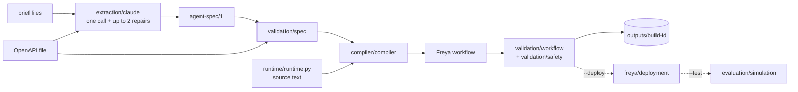

# Architecture

The builder turns a bank's brief and its tool API file into a Freya phone agent. There is one
pipeline and one of everything: one extractor, one spec format, one compiler, one runtime.

## The idea in one paragraph

A language model reads the brief once and writes a compact specification, `agent-spec/1`.
From then on everything is deterministic: the spec is validated against the tool API,
compiled into a six-node Freya workflow, and validated again. The workflow carries two
things: rule text for the phone model, which talks to the person, and a small Python
runtime, embedded in the workflow's code steps and tool hooks, which does the work a model
must not be trusted with: dates, amounts, counting, tool-call limits and the closing outcome.

## Repository

```text
builder/
  __main__.py              python -m builder
  pipeline.py              the stages, in order; the only module that knows all the others
  config/settings.py       paths, defaults, key loading, which variables are secrets
  extraction/claude.py     prompt, Claude call, repair loop
  spec/models.py           agent-spec/1 vocabulary and expression walking
  spec/openapi.py          the bank tool API: operations, fields, $ref
  validation/spec.py       is the spec executable against this API?
  validation/workflow.py   does the workflow obey the platform's rules?
  validation/safety.py     does an artifact carry a credential?
  validation/contract.py   does a request, or a compiled tool, agree with the tool API?
  compiler/compiler.py     spec + API -> workflow; embeds the runtime
  runtime/runtime.py       the deterministic runtime, embedded as source
  freya/client.py          loads the starter kit's freya.py
  freya/deployment.py      dry run, save and publish, export
  freya/versioning.py      slot registry and deployment record
  evaluation/simulation.py the kit's practice customers on Freya
  tracing/trace.py         the build trace, with redaction
  artifacts/store.py       outputs/<build-id>/ and its file names
tests/                     offline tests, one file per area
outputs/                   build artifacts (git-ignored)
local_freya/               the official starter kit (git-ignored)
```

There is no `repair/` package: the repair loop is twenty lines inside the extraction loop
and shares its conversation state, so it stays in `extraction/claude.py`.

## Pipeline



`pipeline.main` runs these stages and writes every result through `artifacts/store` and
every event through `tracing/trace`. The solid part is offline. The dotted part touches
Freya and runs only with its flag. The extraction call runs only with `--live-extract`.

## Module dependencies

Arrows read "imports". `pipeline` imports everything and nothing imports `pipeline` except
`__main__`. There are no cycles; `tests/test_architecture.py` enforces this table.

| Module | Imports |
| --- | --- |
| `runtime/runtime`, `config/settings`, `artifacts/store`, `freya/client`, `evaluation/simulation`, `validation/contract` | nothing from the builder |
| `spec/models` | `runtime/runtime` (the list of date expression kinds) |
| `spec/openapi` | `spec/models` |
| `validation/spec` | `spec/models`, `runtime/runtime` (to evaluate expressions on sample products) |
| `validation/safety` | `config/settings` |
| `validation/workflow` | `validation/safety` |
| `compiler/compiler` | `spec/models`, `runtime/runtime` (located as a file, embedded as text) |
| `extraction/claude` | `spec/models`, `config/settings` |
| `tracing/trace`, `freya/versioning` | `config/settings` |
| `freya/deployment` | `freya/versioning` |

Only three modules can leave the process: `extraction/claude` (the Anthropic SDK, imported
inside the call), `freya/client` (loads the kit client) and `evaluation/simulation`
(starts the kit's test script).

## agent-spec/1

A spec is one JSON object. `spec/models.py` names its vocabulary; the full field list with
explanations is the prompt in `extraction/claude.py`.

| Part | Fields | Read by |
| --- | --- | --- |
| Call | `language`, `call_variables`, `now_variable`, `opening_line`, `test_variables` | compiler |
| Calendar | `calendar.business_weekdays`, `holidays`, `week_start` | runtime |
| Identity | `identity.questions` (field, wording, format, `normalize`), `max_wrong`, response field names, `hints` | runtime |
| Products | `account.values`: named expressions per product; `account.limits`: which values bound a promise (`min_amount`, `max_amount`, `latest_date`, `earliest_date`, `promise_allowed`) | runtime |
| Tools | `promise`, `note`, `callback`, `transfer`, `close`: field names, callback window, outcome table, `close.forced`; `promise.resolve_first`, `promise.min_total`, `promise.allowed_after_transfer_to`, `transfer.max_transfers`; since M16 `promise.amount_step` (with `amount_step_except_max`), `promise.min_amount_by_date`, `promise.same_date`, `callback.closed` | runtime, compiler |
| Guidance | `guidance`: the brief's instruction for a moment after a tool result | runtime |
| Rule text | `rules.always`, `rules.before_verification`, `rules.after_verification`, `tool_descriptions` | phone model |
| Escape hatch | `unsupported`: policy the extractor could not express | validation |

Every field added in M15 and M16 is optional; a spec without it compiles to the behaviour it had.

The four M16 fields are checked by validation, compiled and enforced by the runtime, but **the
extraction prompt does not describe them**: the prompt was frozen for the M15 evaluation and has
not been changed since. An extraction therefore still reports such a rule under `unsupported`.
Until the prompt names them, they reach a build only through a spec that is edited by hand and
passed with `--spec`.

Two names are not in the spec at all, because the tool API states them: the true/false field that
every answer carries (the success flag) and the body fields that are filled from call variables
(the fields that tie a request to the call). `Api.success_flags` and `compiler.runtime_cfg` read
them; `validation/spec.py` refuses a tool API in which they cannot be determined.

Expressions (`runtime.evaluate`): `by` (cases on product fields), `by_time` (cases on the call's clock), `const`, `text`, `field`,
`percent`, `fixed_amount`, and the date kinds `today`, `next_business_day`,
`business_days_after`, `calendar_days_after`, `last_business_day_of_week`,
`first_business_day_of_week`, `end_of_month`, `fixed_date`, `earliest`, `latest`, `named`,
each with optional `roll` and `not_after`.

## The workflow

```text
setup ──► contact ──► get_account ──► account_facts ──► negotiate ──► end
 code     conversation  api_request      code           conversation   end_call
             └──────────────── close_call succeeded ────────┴──► end
```

| Node | What happens | Tools the phone model has |
| --- | --- | --- |
| `setup` | Resets all runtime state; computes calendar and callback slots from the call's clock | none |
| `contact` | Who is on the line; identity | `verify_identity`, `schedule_callback`, `transfer_to_agent`, `close_call` |
| `get_account` | Run by the engine after identity is fully verified | none |
| `account_facts` | Computes every named value and the limits per product | none |
| `negotiate` | The rest of the call | `create_promise`, `add_note` if the brief uses it, `transfer_to_agent`, `close_call` |
| `end` | Hangs up after `close_call` succeeded | none |

Tools are generated from the tool API file: URL, fields, types, enums. Each conversation
node's prompt is the spec's rule text, then what to do when a tool call fails, then facts
blocks the runtime computed (today, day names, calendar, callback slots, account facts with
the limits the bank checks, live state). The day names block gives the date of every day a
person can name in words ("tomorrow", "this Friday", "Monday next week"), so the model
looks a date up and never counts days.

## The embedded runtime

`runtime/runtime.py` is ordinary Python that the tests import directly. The compiler does
not import its functions into the workflow; it reads the file as text (`RUNTIME_SOURCE`),
and for each code step or hook `compiler.runtime_code`:

1. takes the entry function and, by walking the syntax tree, every function it reaches;
2. wraps them, with the configuration as a JSON literal, in one function `_rt`, so they
   see each other under any `exec` scoping;
3. guards the call with `try`, with fallback values for the code steps;
4. refuses to emit code containing a double brace, which Freya would treat as a template.

So the runtime file may use only `json`, `re` and `datetime`, may not import the builder,
and may not contain two consecutive braces. `tests/test_architecture.py` checks all three
and checks that each embedded function equals its source.

State is kept in two layers.

- **Records.** Everything the bank confirmed has a variable of its own: one per promised
  product, one per noted product, one per transfer, one for the callback, one for the result
  of the identity check, and one per `create_promise` request that went out. A record is
  written once, by the post-hook that saw the bank's answer (the request marks by the
  pre-hook that let the request through), and its name carries an id made when the call
  starts, so a variable handed in with the call cannot pass for one.
- **The view.** `rt_state` is one JSON string with the rest: wrong answers, products with
  limits, which close refusals were used, the last refusal. Every hook reads it and then
  completes it from the records before it decides anything.

The reason is how the engine runs the tool calls of one model message, seen in live calls on
2026-10-10. They can run side by side. Each call then works on its own copy of the variables,
taken before any of them started, so no hook sees what another call of the message does.
Afterwards the copies are merged, and for a variable several calls wrote, one write
survives. With everything in `rt_state`, a note saved by one call was erased by the promise
recorded next to it. A variable only one call writes is not affected.

What this cannot do, because no call can see another call of the same message and the tool
API has no idempotency key and no ordering:

- the same call sent twice in one message is carried out twice;
- a `close_call` that reaches the bank before another call of its message makes the bank
  refuse that call, and the close cannot take its outcome from it;
- the text in the prompt (`LIVE STATE`) and the "still open" list in a tool result are
  computed from one call's copy and can be out of date until the next hook runs.

In each of these cases what the model is told about its own call is still true. The prompt
tells the model to send one tool call per message; that is the only defence there is.

### Known platform limitation: the same tool twice in one message

Not fixed, and not fixable from hooks with what the platform provides.

**Root cause.** A post-hook learns which call it belongs to from a variable its pre-hook
wrote (`rt_args_<tool>`). When two calls of the same tool are in one model message, both
pre-hooks write that variable before either post-hook runs, and both post-hooks read the
same value.

**Seen live (M14 Brief B, repetition 2, PUB-12).** Two `add_note` calls started 1 ms apart.
The bank saved both notes. Both post-hooks read the arguments of one call, so the runtime
recorded one note of two, told the model twice that the same product was noted, and refused
the next close once; the repeated close went through.

**Offline.** `tests/freya_sim.py` plays this with `hooks='shared'`, and
`tests/test_concurrency.py` (`SharedHooks`) keeps the reproduction as expected failures.

**Plan A, call-specific context in a post-hook: not available.** The kit documents `result`
as the only name of a post-hook. A probe agent with one tool was run on 2026-10-10 in a
slot of its own (three calls, each with two calls of the tool in one message, started 1 ms,
3 ms and 19 ms apart). In all six post-hooks:

- the names in scope were `result`, `vars`, `json`, `datetime` and two encryption helpers;
  there was no `config`, no arguments, no call or invocation id;
- nothing in `result` (envelope, body, response header names) carried the request;
- a key the pre-hook had put on `config` and a request header it had added were not
  reachable;
- the variable both pre-hooks wrote held the same value in both post-hooks, the one of the
  call started last, in three calls of three;
- the engine's own `<tool>_args.<field>` variable was not set.

The probe also showed how the hooks see each other: every hook ran in an interpreter of its
own; a variable only one pre-hook wrote was visible in both post-hooks; a variable both
pre-hooks appended to held only one append; the second post-hook did not see what the first
post-hook had written a tenth of a second earlier. So a post-hook can see that two calls
were sent, but not which of them it is answering.

**Plan B, serialization: no supported mechanism.** The documented tool settings are
`timeoutMs`, `maxRetries`, `interruptible` and `alwaysRunsAt`. Nodes and the workflow have
no setting for the order or parallelism of tool calls, and the `agent_config` the platform
fills in has none either. The kit's advice, one tool per message, is a prompt instruction;
the model has not always followed it.

**What remains.** For two calls of one tool in one message the bank's records are right,
and the runtime's own record can lack one of them. The effects seen or possible: one tool
result names the wrong product; the next close is refused once although nothing is open
(bounded: a refusal of one kind is given once); and, for two promises, the recorded amount
and date of one product can be those of the other.

**Precautions in place.** The prompt asks for one tool call per message. Records are per operation, so calls of different tools in one message do not
disturb each other. A close refusal is never repeated for the same reason. After a live
run, compare the bank ledger with the runtime's records, not only the score: the ledger and
the judge both passed the call in which this defect occurred.

The reason of a blocked call is kept per tool (`rt_block_<tool>`), and a post-hook never
turns an answer in which the bank carried the call out into a rejection.

## What a block relies on

A blocked call is still sent; a hook can only rewrite it. Every block detaches the request: each body
field that is filled from a call variable is replaced, so the request cannot be attributed to the call
whatever the bank checks. A refused call is never sent in a form the bank could carry out in order to
obtain the bank's refusal.

Until M15 a refused promise or note on a verified call kept its customer and named an unknown product,
so that the bank's own refusal could carry the reason back as the tool result. That held only if the
bank refuses a product id it did not issue. It was removed: the reason of every block now reaches the
model through `LAST REJECTED TOOL CALL` in the live state and the failure rules of the prompt, and the
model sees the blocked call itself as a failed call. Whether the phone model follows that as well as it
followed a tool result is not known; it has not run on Freya.

`tests/test_block_safety.py` plays all 27 places where the runtime blocks under eight namings of the
tool API, against a bank that follows the documented contract and against one that carries out
anything that still names the call: 432 blocked calls, no change at either bank, and no value of the
call left in any blocked request.

Before a call leaves, `send` compares it with the tool API: fields the API does not have are
dropped, a number sent as text is converted, and a missing required field, a value outside an
enum or a date that is not one blocks the call. A call also does not leave while the records of
earlier calls could not be read in full.

A tool API in which a block could not be relied on is not built: a request that carries anything
outside its JSON body, an operation without a required free-text field filled from a call
variable, or no single success flag. `--best-effort` does not override this.

### When a pre-hook fails

A pre-hook whose own code raises used to leave the request as the phone model wrote it. The
wrapper the compiler puts around every pre-hook now detaches the request in that case, using only
the request body and one variable (`compiler.pre_fallback`). `tests/test_hook_faults.py` raises an
error at every point of every pre-hook: no request the policy refuses changes the bank, and a
request that still goes out is one that every check had already passed.

That holds for a close too: a close whose check failed is not sent, however often it is tried. The
runtime retries nothing itself. If the fault does not go away the agent cannot close the call, and the
call ends at the platform's turn limit without an outcome at the bank; that is the price of not sending
an unchecked close, and nothing a hook can do recovers from it.

One limit remains and no claim here goes beyond it. If the platform does not run a pre-hook at all,
skips it or stops it, nothing of ours runs and the request goes out unchecked. The kit does not say
that a hook always runs. Every rule below that is "enforced by the runtime" holds only when the
pre-hook ran to its end or failed inside our own code.

A compiled tool that departs from the tool API (URL, method, fields, types, allowed values) fails the
build. `send` checks every outgoing request again.

## How a refusal or a failure reaches the model

Live calls showed two things the design has to work around. The engine runs a post-hook
only after a 2xx answer; after any other status the model gets a bare error. And tool calls
that the model puts into one message are not run in the order written.

| Situation | What the runtime does | How the model learns of it |
| --- | --- | --- |
| A call breaks a rule | The pre-hook detaches the request from the call; the bank answers with an HTTP error and records nothing | `LAST REJECTED TOOL CALL` in the live state, followed by a line that says the call was stopped by the policy check, is not a service failure and recorded nothing; and the fixed failure rules in the prompt. Whether the model reads it so is not verified live |
| The service fails (HTTP error) | Every `create_promise` request that goes out leaves a variable of its own. Requests for a product that has no recorded promise have failed, with or without an answer, and are counted | The fixed failure rules in the prompt, per tool, with the spec's own guidance; the live state repeats them while the mark is there |
| More promise attempts than the spec allows | `pre_promise` blocks the call | As in the first row |
| A pre-hook's own code fails | The wrapper detaches the request | The model sees a failed call; there is no reason to give |
| A close breaks a rule of the outcome table or leaves products open | `pre_close` blocks it, once per kind of problem; the next close goes through | `LAST REJECTED TOOL CALL` in the live state only: a close has no answer that could carry the reason |

## What is enforced in code, and what is not

Enforced by the runtime or by the graph, whatever the phone model does:

| Rule | Where |
| --- | --- |
| No account tool before identity is fully verified | graph: the tools exist only in `negotiate`; `get_account` is engine-run |
| State supplied by the caller is discarded | `setup` |
| Wrong answers counted across questions; hints and unreadable answers not counted; the lower of the brief's and the service's limit ends the check; a failed check stays failed whatever the service answers | `pre_identity`, `post_identity` |
| Promise amount within the limits; date not past, not before the earliest date, not after the latest date, a business day | `pre_promise` |
| Promise amount a whole multiple of a step, counted in cents; a promise dated on or before a given date needs a given lowest amount | `pre_promise` |
| All promises of a call on one date: a later promise takes the date already recorded or is refused, and the first promise goes to the first open product, so that two first promises sent in one message cannot record two dates. **Partial:** the date of the first promise cannot be changed afterwards; if a later product cannot take it, that product gets no promise | `pre_promise` |
| No promise for a product whose limits the bank's data did not let the runtime work out (a limit that is missing is not read as no limit) | `product_facts`, `pre_promise` |
| One promise per product; known product only; none after a transfer (except to a queue the spec names); none without a loaded account; none for a product the spec excludes; none while a product that comes first is open | `pre_promise` |
| A promise is refused once the required total of all promises can no longer be reached. **Partial:** a promise already recorded cannot be taken back, so "all or none" is not enforced | `pre_promise` |
| No transfer beyond the number the spec allows | `pre_transfer` |
| A text answer to a security question is sent in the form the spec prescribes | `pre_identity` |
| Every request has the fields, types and allowed values of the tool API | `send` |
| One note per product; none for a promised product; none after a transfer when the spec says so; only a reason the tool API lists | `pre_note` |
| Callback only inside the computed slots, outside every closed period of the day; only one | `pre_callback` |
| Retry-or-stop after a failed `create_promise`, by attempt count; no attempt beyond the limit | `pre_promise`, `post_promise` |
| A record made by one call of a message survives the other calls of that message | one variable per record; `load_state` |
| A close with open products (when the brief uses notes), without the reason its outcome needs, or with an unknown outcome is refused, once per kind of problem | `pre_close` |
| Close outcome from what was recorded (`close.forced`), including a note with a given reason beside a promise; no reason on an outcome that takes none | `pre_close` |
| The call ends only after `close_call` succeeded | graph |
| Calendar, deadlines, floors, offer dates | computed in `setup` and `account_facts`, given to the model as facts |

Left to the phone model, guided by rule text and by `what_to_do_next`, and therefore not
deterministic: recognising who is on the line and what the person means; what may be said
before verification; asking in the prescribed order; counting persuasion attempts and
"offer once" rules; reading back and waiting for a clear yes before `create_promise`;
choosing the outcome where it depends on what was said; saying prescribed sentences;
adding a note for each product without a promise before closing.

## Validation, tests and evaluation are three different things

| What | Where | Proves |
| --- | --- | --- |
| Spec validation | `validation/spec.py`, on every build | The spec names only fields, values and operations the API has, and its expressions compute |
| Workflow validation | `validation/workflow.py`, on every build | The workflow obeys the documented platform rules |
| Safety validation | `validation/safety.py`, on spec and workflow | No credential in an artifact |
| Tool API contract | `validation/contract.py`, on every build as trace lines, never a reason to fail; on every request the benchmarks play | Compiled tools and outgoing requests have the URL, method, fields, types and allowed values of the tool API. A keyword of the document it does not implement is reported as not checked |
| Platform dry run | `freya/deployment.py`, with `--deploy` | The platform accepts the workflow |
| Offline tests | `tests/`, with `tests/freya_sim.py` standing in for the engine and the bank | The runtime does the right thing when given a tool call |
| Real evaluation | `evaluation/simulation.py`, with `--test` | A phone agent on Freya handles the practice customers |

The offline tests play the phone model's tool calls by hand. They say nothing about what
the phone model will actually do.

## Deployment and versions

All platform calls go through the starter kit's `freya.py`; the builder adds none.

| Question | Answer |
| --- | --- |
| How is a workflow id assigned? | By Freya, when a slot is saved for the first time |
| Where is it kept? | `.freya-agents.json` (slot → workflow id, agent id, version), written by the kit |
| Can a workflow be updated? | Yes. Saving a known slot replaces the definition of the same workflow |
| Are save and publish separate? | Not in the path the builder uses. `save_workflow` on a known slot updates **and publishes** |
| Can the deployed workflow be read back? | Yes, `export_workflow`; the builder does it after every deploy |
| Local vs deployed comparison? | Not implemented. The platform adds its own fields to a stored workflow |
| Rollback? | Not implemented. The platform keeps versions and has a publish call; the kit has no helper for an older version |
| Which build is deployed? | `outputs/<build-id>/deployment.json`: ids, created or updated, platform version, hash of the local workflow |

`--deploy` is the only gate. There is no approval step and no diff before an update.

## Artifacts

One folder per build, named after the slot. A file exists only if its stage ran.

```text
outputs/<build-id>/
  spec.json                 the agent-spec/1 used
  workflow.json             the compiled, locally validated workflow
  trace.txt                 the run: start, end, each model call, platform actions, tests
  deployment.json           with --deploy
  exported.workflow.json    with --deploy; the file to submit
  evaluation.json           with --test
```

## Verified and not verified

Verified offline: the tests pass; the Brief A and Brief A+B fixture specs compile to
workflows that pass local validation.

Verified in live calls on 2026-10-10, with the code before the changes described under
"How a refusal or a failure reaches the model": Claude wrote a valid spec for Brief A in
one request; Freya accepted workflows of about 130 to 145 KB and stored hooks and code
unchanged; post-hooks run after a 2xx answer and their text reaches the model; variables
written in hooks persist; a detached call records nothing; a post-hook does not run after
an HTTP error; calls of one message are not kept in order.

Not yet verified live:

- that the bank answers a request with an unknown product id with a refusal the post-hook
  can explain (the kit's README says it answers `unknown product_id`; the status is assumed);
- how exactly the variables of side-by-side calls are merged. Seen: a variable only one call
  wrote survives, and for `rt_state` the call that came last in the message won. Not known:
  whether a call writes back variables it did not change. The records are safe either way;
- whether the bank itself refuses a second promise for a product;
- what a phone model does after a refused close, which it sees only as a failed call;
- that Freya accepts a workflow of about 200 KB (185 KB was accepted);
- that the phone model uses the day names block and the failure rules;
- amount blocks, callback blocks, notes and calls with several products.

Not verified live after M15: any workflow built with the code of this milestone. The runtime and the
hook wrappers changed, and the workflows are larger (Brief A about 232 KB, Brief A+B about 258 KB;
the largest accepted so far was about 231 KB).

Other limits: the tests and `--deploy` need the git-ignored starter kit; persuasion
counting and other conversational rules are prompt-dependent; the tool names are assumed
to be the seven of the starter kit.
